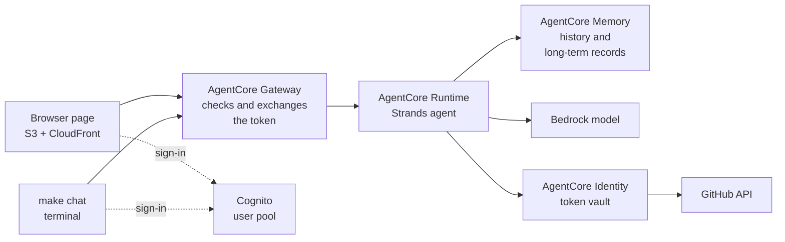

# team-assistant

A demo agent on Amazon Bedrock AgentCore. A team member signs in, chats with an assistant in
the browser or the terminal, and the assistant remembers the conversation, the user's
preferences and facts across conversations, and reads GitHub issues with the user's own GitHub
authorization.


https://github.com/user-attachments/assets/41862dc0-2811-4d38-b5fb-035fe27bb614


> **This is a demonstration project, not a product.** It shows how AgentCore's building
> blocks fit together with per-user identity end to end. It has been deployed and checked
> against a real AWS account, but it has no alarms, no load testing, no backup and no
> support. Use it to learn from or as a starting point, not as a finished system.

## What it shows

- **The user's identity decides everything.** The agent takes the user id from a verified
  Cognito token (`sub`), never from the request. Conversation history, long-term memory and the
  GitHub token are all keyed by it; two users never see each other's data, and a session id
  in use by one user is refused to another.
- **One way in.** An AgentCore Gateway checks the token, exchanges it for one bound to the agent
  (OAuth token exchange, RFC 8693) and relays the request. The AgentCore Runtime accepts only
  requests that came through this gateway; the same valid token sent straight to the Runtime is
  refused.
- **Memory that outlives a session.** Each conversation is kept in AgentCore Memory. Three
  built-in strategies extract preferences, facts and summaries in the background. Later
  conversations start with the user's preferences in the system prompt, and the model looks
  up facts and earlier conversations with its memory tools.
- **Acting with the user's own credentials.** The GitHub tools get the user's GitHub token from
  AgentCore Identity after a one-time consent in the browser (OAuth authorization code). The
  user needs no AWS credentials, and the token never reaches the model or the logs.
- **A static web page.** S3 behind CloudFront, sign-in with Cognito (PKCE), streamed Markdown
  answers, the GitHub consent inside the chat, and a list of earlier conversations read from
  Memory. No server of its own.
- **Operated like a product.** Everything is a `make` target in a pinned runner image;
  infrastructure is AWS CDK with least-privilege roles under a permissions boundary and a
  dedicated CDK bootstrap; `make smoke` checks the deployed environment end to end;
  `make destroy` removes everything.

## Architecture



The request path, the GitHub consent and the web page step by step:
[docs/architecture.md](docs/architecture.md).

## Design rules

- **AWS-maintained agent components only:** `strands-agents`, `bedrock-agentcore`, `boto3`,
  `aws-opentelemetry-distro`, `aws-cdk-lib` and `constructs` (with the `aws-cdk` command
  line). No community memory back ends, tool packages or MCP servers.
- **No caller-chosen keys:** memory is never keyed by a value the client can set.
- **No long-lived secrets** in the repository, images or environment variables. Account ids and
  other identifiers live only in the gitignored `local.mk`; git hooks and gitleaks stop a
  commit that contains one.
- **No fixed monthly fees** except two Secrets Manager secrets AgentCore requires while an
  environment is deployed.

## Limits

- No alarms and no log retention; traces are built but off by default
  ([docs/security.md](docs/security.md), "Traces").
- Separation between users rests on the agent's code: one IAM role serves all users.
- The GitHub tools only read public repositories.
- Not tested under load.
- The web page is desktop only.

## Use it

You need an AWS account, Docker and a GitHub account. Everything runs through `make`;
`make help` lists the targets. [docs/runbook.md](docs/runbook.md) goes from an empty account to
a conversation.

```
cp local.mk.example local.mk                # profile, region, account id
make runner && make hooks && make check     # tools and tests, no AWS
make bootstrap ENV=dev                      # once per account and region
make arm64 && make deploy ENV=dev           # prints the page's address
make user ENV=dev USER=alice && make login ENV=dev USER=alice
make chat ENV=dev USER=alice
make smoke ENV=dev                          # end-to-end checks
make destroy ENV=dev
```

`make web MOCK=1` runs the page on `http://localhost:5173` against a mock agent, without AWS.

## Repository

| Path | Content |
|---|---|
| `src/team_assistant/` | the agent (Python, Strands) |
| `web/` | the page (TypeScript, Vite, Vitest) |
| `infra/` | the stack and the CDK bootstrap (AWS CDK, Python) |
| `scripts/` | the operator's tools: login, chat, users, smoke |
| `docker/` | the agent image and the pinned runner image |
| `config/agent.toml` | model, memory, tracing |

| Document | Content |
|---|---|
| [docs/architecture.md](docs/architecture.md) | the parts and the path of a request |
| [docs/runbook.md](docs/runbook.md) | deploy, use, tear down, troubleshoot |
| [docs/security.md](docs/security.md) | who can do what; every permission of the agent's role; residual risks |
| [docs/adr/](docs/adr/) | decisions: CDK bootstrap, Cognito, the JWT authorizer, the gateway as the only entry, the page's hosting, long-term memory |

## License

[MIT](LICENSE)
