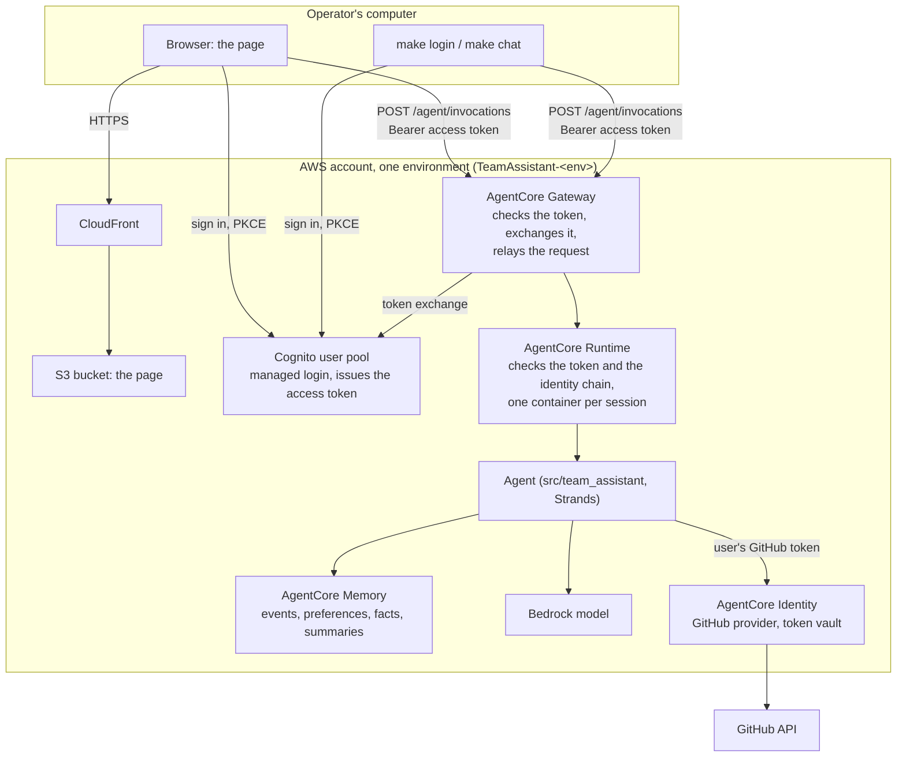

# Architecture

## Parts

The agent's modules:

| Module | Role |
|---|---|
| `identity.py` | user id = the `sub` claim of the token |
| `memory.py` | history of (user id, session id); long-term records into the prompt |
| `app.py` | model call, streamed answer |
| `github.py` | tools `list_issues`, `get_issue`, with the user's GitHub token |
| `consent.py` | completes a GitHub consent |
| `conversations.py` | the page's conversation list and history |
| `titles.py` | a title after a session's first answer |
| `config.py` | settings from `config/agent.toml` |
| `events.py` | the stream events sent to the client |
| `logs.py` | log lines of other libraries without their values |

Memory keeps events for 30 days. About a minute after the messages, three strategies extract
long-term records into `/preferences/{actorId}/`, `/facts/{actorId}/` and
`/summaries/{actorId}/{sessionId}/`. The GitHub client secret is in Secrets Manager.

## A request, step by step

1. `scripts/chat.py` takes the user's access token from the local cache (refreshing it when it
   is about to expire) and posts `{"prompt": ...}` with a session id to the gateway
   (`<GatewayUrl>/agent/invocations`). The gateway checks the token (pool, app client,
   audience), exchanges it at the user pool for a token of the same user bound to the agent,
   and relays the request; only such a request carries the gateway in its identity chain,
   which the Runtime requires.
2. The Runtime's JWT authorizer checks the token against the user pool, the allowed app
   client and the audience (the token must have been issued for this environment's agent).
   A request without a valid token is refused with 401 at the gateway or here.
3. The Runtime routes the request to the container of that session, starting one if needed.
4. `app.py` checks the prompt, reads the user id from the token (`identity.py`), refuses a
   session id that another user used first in this container, and opens the history for
   (user id, session id) in AgentCore Memory (`memory.py`).
5. The session manager searches the user's preference and fact namespaces with the new message
   (`RetrieveMemoryRecords`, limits from `[memory.retrieval.*]` in `config/agent.toml`) and
   prepends what it finds to that message inside `<user_context>`. A failed search is logged as
   a WARNING and the answer goes on without those records.
6. The Strands agent sends the history and the new message to the model and streams the answer
   back as server-sent events; the session manager stores both messages as events.
7. About a minute later, outside the request, the three strategies extract long-term records
   from the new events. Summaries are kept for the operator (`make memory`), never retrieved.
8. One log line records the user id, the session id and the token counts; never the content.

## GitHub consent, the first time a user asks for issues

1. The model calls `list_issues`. Its inner function asks AgentCore Identity for the user's
   GitHub token (`requires_access_token`, flow `USER_FEDERATION`, no scope). There is none yet,
   so Identity returns a consent URL; the tool keeps polling the vault for up to 600 s.
2. The agent streams `{"type": "auth_url", "url": ..., "state": ...}` at once.
3. `make chat` listens on `127.0.0.1:8977` and prints the URL. The user consents in GitHub; the
   browser returns to `http://localhost:8977/github/callback` with `session_id` and `state`.
4. The client checks the state and sends `{"consent": {"session_uri": ...}}` to the agent with
   the same user's Cognito token, in a new runtime session.
5. The agent (`consent.py`) calls `CompleteResourceTokenAuth` with its role, naming the user by
   that token. Users have no AWS credentials; only the agent's role can complete a binding.
6. Identity stores the token in the vault for (this agent, this user). The waiting tool gets it,
   calls `GET /repos/{owner}/{repo}/issues` and the answer goes on. Later requests of the same
   user get the token from the vault without consent.

The return URL is registered on the Runtime's workload identity by `make deploy`
(`UpdateWorkloadIdentity`), because CloudFormation has no field for it.

## The web page

1. CloudFront serves the page from a private bucket (only this distribution can read it) with
   fixed security headers; `make deploy` uploads the built page with `config.json` (gateway,
   login domain, app client, audience) and a Content Security Policy meta tag naming exactly
   the gateway and the login domain.
2. The page signs in like `make login`: Cognito's managed login, authorization code with PKCE,
   the agent's audience, the same app client. Tokens stay in the tab's `sessionStorage`.
3. Messages go to `<GatewayUrl>/agent/invocations` with `client: "web"` (`"web-local"` on the
   development server); the answer streams as
   server-sent events and is rendered from Markdown (raw HTML, images and non-http links off).
4. `{"conversations": {}}` and `{"history": {}}` ask the agent for the user's sessions
   (`ListSessions`, titles from a title event) and one session's turns (`ListEvents`); no model
   call, the actor is always the token's. After a session's first answer the agent asks the
   model for a short title and stores it in Memory as an event of its own.
5. A GitHub consent spans two tabs: the chat tab keeps the `state`, the consent opens GitHub in
   a new tab, GitHub returns it to `callback.html`, which hands `session_id` and `state` to the
   chat tab over a `BroadcastChannel`; the chat tab sends the consent to the agent only for the
   waiting state. The agent picks the return URL from its own list by the client's name.

## What is deployed where

| Stack | Content | Lifetime |
|---|---|---|
| `team-assistant-cdk-policies`, `TeamAssistantToolkit` | the CDK bootstrap of this project: deploy permissions, assets bucket, image repository | once per account and region |
| `team-assistant-<env>-boundary` | the permissions boundary of the environment's roles | with the environment |
| `TeamAssistant-<env>` | user pool, app client, login domain and style, resource server (the audience), Memory, Runtime, the agent's role, the gateway with its target and role, the token exchange provider and its placeholder secret, GitHub credential provider and its client secret; the page's bucket, CloudFront distribution, origin access control and response headers policy | with the environment |
| (none) | the GitHub OAuth App, created by hand in GitHub; the token vault, one per account and region, created by AgentCore | outlast the environment |

## Not built

- Traces are implemented but off by default (docs/security.md, "Traces").
- No alarms and no log retention: logs are kept until `make destroy`.

Operation: docs/runbook.md.
Permissions: docs/security.md. Decisions: docs/adr/.
